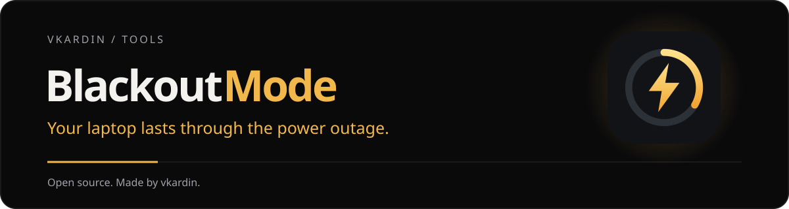
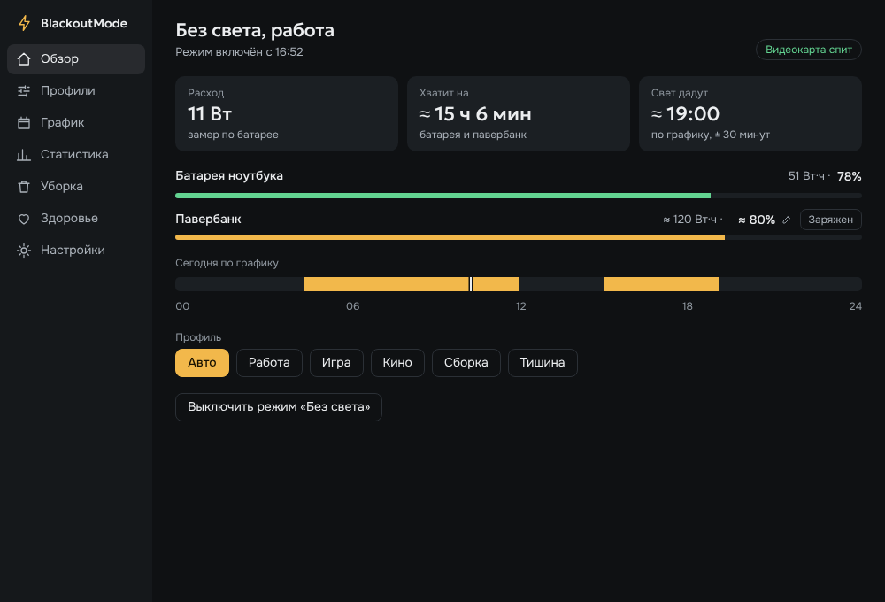
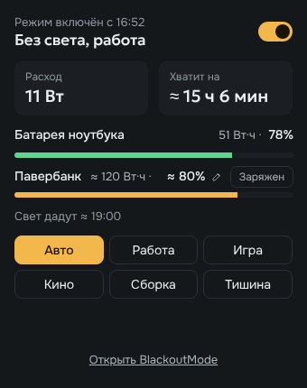
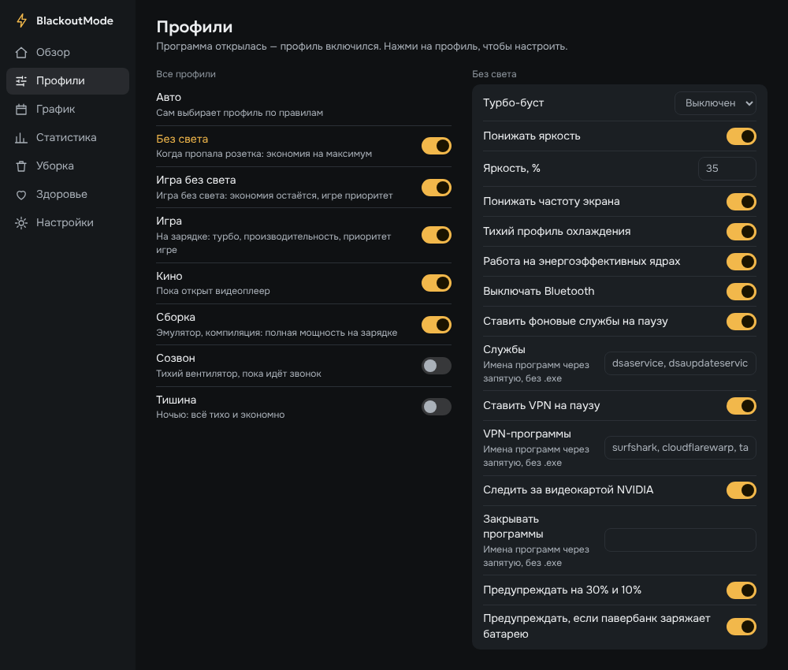
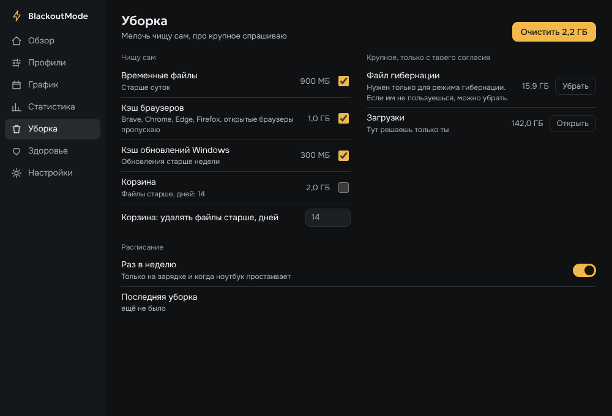

<p align="center"></p>

<h1 align="center">BlackoutMode</h1>

<p align="center"><b>Your laptop lasts through the power outage</b><br>
English · <a href="README.ru.md">Русский</a> · <a href="README.uk.md">Українська</a></p>

<p align="center">
<a href="https://github.com/vkardin/blackoutmode/releases/latest"></a>
<a href="https://vkardin.github.io/blackoutmode/"></a>
<a href="LICENSE"></a>
</p>

A small Windows tray app I wrote to keep my laptop alive through power outages. When the charger goes dead it squeezes the power draw, and when the grid is back it puts everything the way it was. Over time it grew profiles for games, films and builds, a power bank counter, a weekly clean-up and a window to see what is going on. Free, no account, nothing leaves your laptop.

<p align="center"></p>

## Install

1. Download `BlackoutMode-x.y.z.exe` from [Releases](../../releases/latest) and put it anywhere.
2. Run it. A lightning icon appears in the tray, and the window asks three things on the first run: what power bank you have and where you live, for the outage schedule.
3. Left click opens the small panel, right click a short menu. All settings are in the window.

Windows 10 or 11. Administrator rights are optional: without them pausing services, the cooling profile and part of the clean-up are skipped. New versions are picked up by the program itself: it tells you, you press **Update**.

## What it does

- **No-power mode.** Turns on by itself when the charger is gone: turbo boost off, efficient cores first, lower screen refresh rate and brightness, Bluetooth off, background services and VPN clients paused. On my laptop this takes the draw from 30–60 W down to 12–17 W
- **How long it lasts.** The draw is measured on battery and remembered separately for work, films and games, so the time left is honest on a power bank too, where it cannot be measured
- **Power bank.** Counts how much is left in it. Click its percent and type what the bank shows: the estimate is corrected, and the program learns how much the bank really gives
- **Outage schedule.** For Ukraine it reads the open data of [Koly Ye](https://vkardin.github.io/koly/): warns before an outage, tops the battery up beforehand and switches back when power returns
- **Profiles.** Game (full power on the charger), game without power (built-in graphics so the discrete card sleeps), film, build, call, quiet. A program opens, its profile turns on. You can also pick one by hand
- **What the saving gives.** One button compares three minutes without saving and three with it and shows the difference in watts on your laptop
- **On-screen widget.** Charge, time left and two thin bars, battery and power bank, in a corner of the screen while the power is out
- **Clean-up.** Temporary files, browser and Windows update caches, old items in the recycle bin. Once a week, only on the charger and when the laptop is idle
- **Health.** Battery wear, temperature, disks, and a warning when something new adds itself to autostart
- **Statistics.** A chart of the last run on battery, draw per mode and the history of outages
- Light and dark theme, English, Русский, Українська

| Small panel by the tray | Profiles | Clean-up |
|---|---|---|
|  |  |  |

## What works where

On first start the program checks what the laptop has and hides what is missing.

| Feature | Needs |
|---|---|
| No-power mode, profiles, schedule, power bank, clean-up, statistics | any laptop |
| Cooling profile, battery charge limit, telling the charger from a power bank | Lenovo IdeaPad or Legion |
| Putting the discrete card to sleep | built-in graphics plus NVIDIA |
| Lower refresh rate | a screen that offers one |

I use it every day on my Lenovo. Other laptops: not verified yet. Please [report](../../issues/new/choose) what you find.

## Privacy

BlackoutMode collects no data. Settings, the log and the statistics live next to the exe (or in `%AppData%\BlackoutMode` when that folder is read-only). The only things it downloads are the outage schedule and, once a day, the number of the latest version. Telegram messages go out only if you set up your own bot.

## Feedback and support

- Ideas and bug reports: [GitHub Issues](../../issues/new/choose)
- Support the project: [Ko-fi](https://ko-fi.com/vkardin) or [Donatello](https://donatello.to/vkardin)

## Build

Go 1.24 and the LLVM tools for the resources. The three libraries it needs are in `third_party`, nothing is downloaded:

```
sh tools/build.sh
```

The window is drawn by the WebView2 component that ships with Windows 11 (and with up-to-date Windows 10). Where it is missing, a plain browser window is used instead. Nothing of the window stays in memory after you close it.

## Repository

| Folder | What is inside |
|---|---|
| `*.go` | The program. Files ending in `_windows.go` talk to Windows, the rest is plain logic covered by `core_test.go` |
| [`ui/`](ui) | The window: one HTML file and the fonts |
| [`res/`](res) | Icon, manifest and version resource |
| [`third_party/`](third_party) | go-webview2, go-winloader and the Windows part of golang.org/x/sys, each under its own licence |
| [`tools/`](tools) | `build.sh` runs the tests and builds `dist/BlackoutMode-<version>.exe` |
| [`.github/workflows/`](.github/workflows) | `test.yml` runs the tests and the Windows build; `release.yml` publishes a release when a new version from `main_windows.go` reaches `main` |

## License

[MIT](LICENSE) © vkardin. Fonts: Geologica and Onest, SIL Open Font License (see `ui/f`).

<!-- project-family:start -->

[**vkardin / tools — all projects ↗**](https://vkardin.github.io/)
## More tools by vkardin

| Project | Projects |
| --- | --- |
| **[Video Glow](https://vkardin.github.io/video-glow/)** | Ambient light around web videos. Soft glow, LED strips and room colour. [GitHub](https://github.com/vkardin/video-glow) |
| **[Leveler](https://vkardin.github.io/leveler/)** | Even loudness for any video: louder dialogue, softer explosions, volume boost and speed. [GitHub](https://github.com/vkardin/leveler) |
| **[Video Drift](https://vkardin.github.io/video-drift/)** | Floating video with subtitles, saved playback positions and timestamped notes. [GitHub](https://github.com/vkardin/video-drift) |
| **[Snapt](https://vkardin.github.io/snapt/)** | Capture, annotate and export. A Windows, macOS and Linux app, plus a browser extension. [GitHub](https://github.com/vkardin/snapt) |
| **[UNI](https://vkardin.github.io/uni-homebot/)** | Your home server in Telegram: apps, monitoring, notifications and a Mini App. [GitHub](https://github.com/vkardin/uni-homebot) |
| **[Коли Є](https://vkardin.github.io/koly/)** | Power outage schedules for every region of Ukraine: status now, a countdown, today and tomorrow. Android app and Windows widget. [GitHub](https://github.com/vkardin/koly) |
| **[Tukk](https://vkardin.github.io/tukk/)** | Phone gestures for everyday actions: shake for the flashlight, flip for silence. Android, in development. [GitHub](https://github.com/vkardin/tukk) |

[github.com/vkardin](https://github.com/vkardin) · Independent tools · open source
<!-- project-family:end -->
