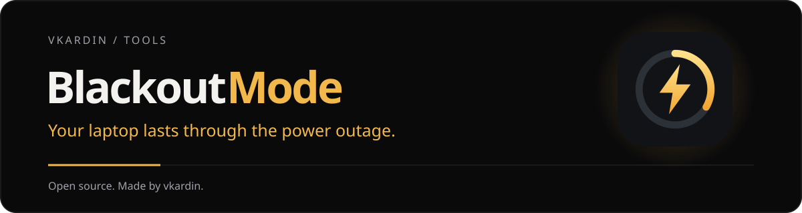
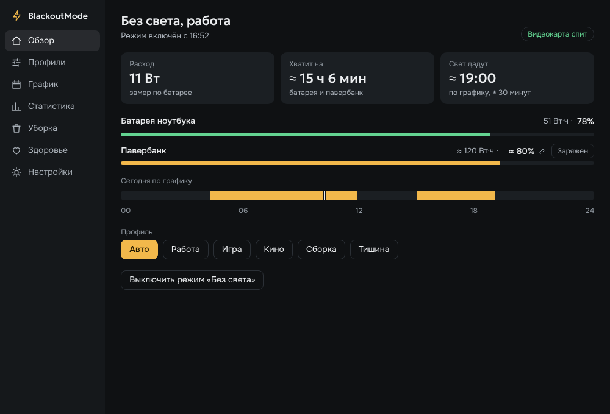
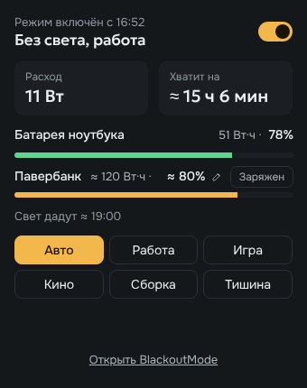
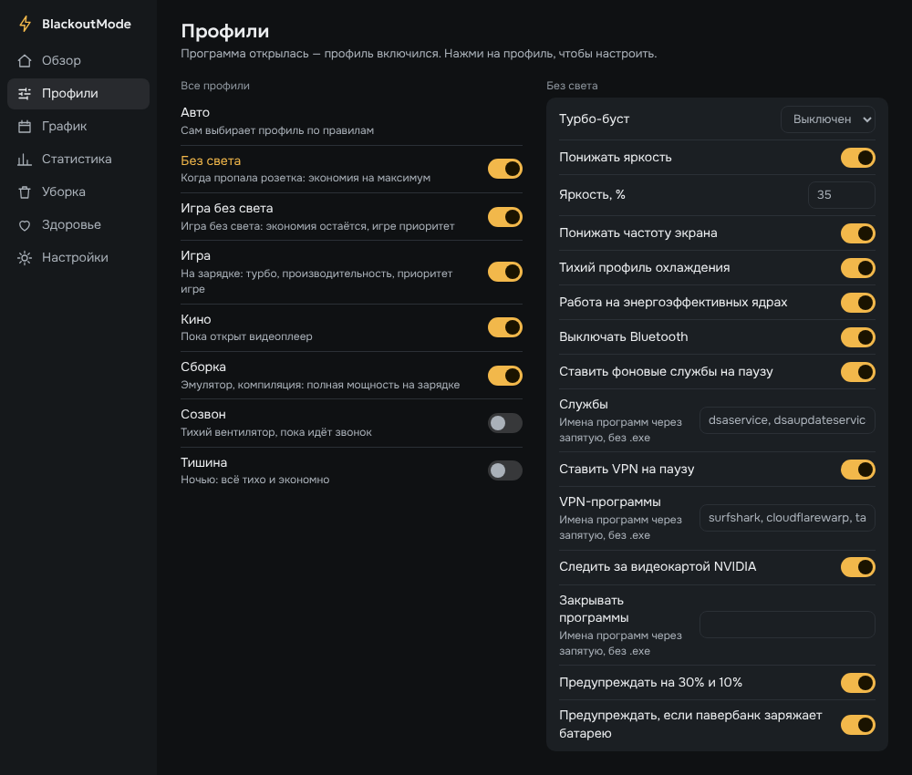
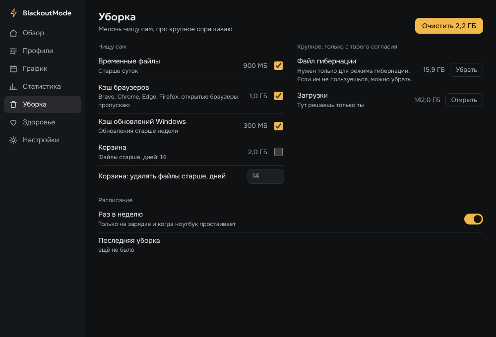

<p align="center"></p>

<h1 align="center">BlackoutMode</h1>

<p align="center"><b>Ноутбук доживает до конца отключения</b><br>
<a href="README.md">English</a> · Русский · <a href="README.uk.md">Українська</a></p>

<p align="center">
<a href="https://github.com/vkardin/blackoutmode/releases/latest"></a>
<a href="https://vkardin.github.io/blackoutmode/ru/"></a>
<a href="LICENSE"></a>
</p>

Небольшая программа в трее Windows. Я написал её, чтобы ноутбук доживал до конца отключения света. Когда пропадает розетка, она сжимает расход, а когда свет возвращается, ставит всё как было. Со временем появились профили для игр, кино и сборки, учёт павербанка, еженедельная уборка и окно, где видно, что происходит. Бесплатно, без регистрации, с ноутбука ничего не уходит.

<p align="center"></p>

## Установка

1. Скачайте `BlackoutMode-x.y.z.exe` из [Releases](../../releases/latest) и положите куда удобно.
2. Запустите. В трее появится значок с молнией, а окно при первом запуске спросит три вещи: какой у вас павербанк и где вы живёте, чтобы брать график отключений.
3. Левый клик открывает мини-панель, правый — короткое меню. Все настройки в окне.

Windows 10 или 11. Права администратора не обязательны: без них не ставятся на паузу службы, не переключается профиль охлаждения и пропускается часть уборки. Новые версии программа находит сама: сообщает, вы нажимаете **«Обновить»**.

## Что умеет

- **Режим без света.** Включается сам, когда пропала розетка: турбо-буст выключен, работа идёт на энергоэффективных ядрах, частота и яркость экрана ниже, Bluetooth выключен, фоновые службы и VPN на паузе. На моём ноутбуке расход падает с 30–60 Вт до 12–17 Вт
- **На сколько хватит.** Расход замеряется от батареи и запоминается отдельно для работы, кино и игр, поэтому оставшееся время честное и от павербанка, где его измерить нельзя
- **Павербанк.** Считает, сколько в нём осталось. Кликните по его проценту и введите то, что показывает павербанк: оценка поправится, а программа поймёт, сколько он отдаёт на самом деле
- **График отключений.** Для Украины берёт открытые данные [«Коли Є»](https://vkardin.github.io/koly/ru/): предупреждает заранее, дозаряжает батарею перед отключением и сама возвращает обычный режим, когда дали свет
- **Профили.** Игра (полная мощность на зарядке), игра без света (встроенная графика, чтобы видеокарта спала), кино, сборка, созвон, тишина. Открылась программа — включился профиль. Можно выбрать и вручную
- **Сколько даёт экономия.** Одна кнопка сравнивает три минуты без экономии и три с ней и показывает разницу в ваттах на вашем ноутбуке
- **Виджет на экране.** Заряд, оставшееся время и две тонкие полоски, батарея и павербанк, в углу экрана, пока нет света
- **Уборка.** Временные файлы, кэш браузеров и обновлений Windows, старое в корзине. Раз в неделю, только на зарядке и когда ноутбук простаивает
- **Здоровье.** Износ батареи, температура, диски и предупреждение, когда что-то новое прописалось в автозагрузку
- **Статистика.** График расхода за последнюю работу от батареи, расход по режимам и история отключений
- Светлая и тёмная тема, English, Русский, Українська

| Мини-панель у трея | Профили | Уборка |
|---|---|---|
|  |  |  |

## Что где работает

При первом запуске программа смотрит, что есть на ноутбуке, и прячет то, чего нет.

| Возможность | Что нужно |
|---|---|
| Режим без света, профили, график, павербанк, уборка, статистика | любой ноутбук |
| Профиль охлаждения, лимит зарядки, отличить зарядку от павербанка | Lenovo IdeaPad или Legion |
| Усыпить дискретную видеокарту | встроенная графика плюс NVIDIA |
| Пониженная частота экрана | экран, который её поддерживает |

Сам я пользуюсь ею каждый день на своём Lenovo. Другие ноутбуки пока не проверены. Пожалуйста, [напишите](../../issues/new/choose), что у вас получилось.

## Приватность

BlackoutMode не собирает данных. Настройки, журнал и статистика лежат рядом с exe (или в `%AppData%\BlackoutMode`, если в ту папку нельзя писать). Скачивает программа только график отключений и раз в сутки номер последней версии. Сообщения в Telegram уходят, только если вы настроили своего бота.

## Обратная связь и поддержка

- Идеи и ошибки: [GitHub Issues](../../issues/new/choose)
- Поддержать проект: [Ko-fi](https://ko-fi.com/vkardin) или [Donatello](https://donatello.to/vkardin)

## Сборка

Go 1.24 и инструменты LLVM для ресурсов. Три нужные библиотеки лежат в `third_party`, ничего не скачивается:

```
sh tools/build.sh
```

Окно рисует компонент WebView2, который есть в Windows 11 (и в обновлённой Windows 10). Где его нет, открывается обычное окно браузера. После закрытия окна в памяти от него ничего не остаётся.

## Репозиторий

| Папка | Что внутри |
|---|---|
| `*.go` | Программа. Файлы с окончанием `_windows.go` работают с Windows, остальное — обычная логика, покрытая тестами в `core_test.go` |
| [`ui/`](ui) | Окно: один HTML-файл и шрифты |
| [`res/`](res) | Значок, манифест и ресурс с версией |
| [`third_party/`](third_party) | go-webview2, go-winloader и часть golang.org/x/sys для Windows, у каждой своя лицензия |
| [`tools/`](tools) | `build.sh` прогоняет тесты и собирает `dist/BlackoutMode-<версия>.exe` |
| [`.github/workflows/`](.github/workflows) | `test.yml` запускает тесты и сборку под Windows; `release.yml` публикует релиз, когда в `main` приходит новая версия из `main_windows.go` |

## Лицензия

[MIT](LICENSE) © vkardin. Шрифты: Geologica и Onest, SIL Open Font License (см. `ui/f`).

<!-- project-family:start -->

[**vkardin / tools — каталог всех проектов ↗**](https://vkardin.github.io/)
## Другие инструменты от vkardin

| Проект | Описание |
| --- | --- |
| **[Video Glow](https://vkardin.github.io/video-glow/)** | Подсветка вокруг видео в цвет кадра. Мягкое свечение, LED-лента и цвет комнаты. [GitHub](https://github.com/vkardin/video-glow) |
| **[Leveler](https://vkardin.github.io/leveler/)** | Ровная громкость любого видео: диалоги громче, взрывы тише, усиление и скорость. [GitHub](https://github.com/vkardin/leveler) |
| **[Snapt](https://vkardin.github.io/snapt/)** | Скриншоты, стрелки и подписи. Приложение для Windows, macOS и Linux и расширение браузера. [GitHub](https://github.com/vkardin/snapt) |
| **[Video Drift](https://vkardin.github.io/video-drift/)** | Видео поверх других окон, субтитры, сохранение позиции и заметки к моментам. [GitHub](https://github.com/vkardin/video-drift) |
| **[Коли Є](https://vkardin.github.io/koly/ru/)** | Графики отключений света по всем областям Украины: статус сейчас, обратный отсчёт, сегодня и завтра. Приложение для Android и виджет для Windows. [GitHub](https://github.com/vkardin/koly) |
| **[Tukk](https://vkardin.github.io/tukk/ru/)** | Жесты телефоном для повседневных действий: встряхнуть для фонарика, перевернуть для тишины. Android. [GitHub](https://github.com/vkardin/tukk) |
| **[UNI](https://vkardin.github.io/uni-homebot/)** | Домашний сервер в Telegram: приложения, мониторинг, уведомления и мини-приложение. [GitHub](https://github.com/vkardin/uni-homebot) |

[github.com/vkardin](https://github.com/vkardin) · Независимые инструменты · открытый код
<!-- project-family:end -->
