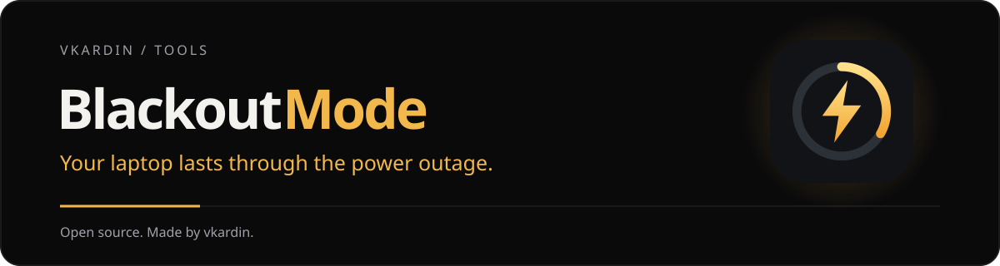
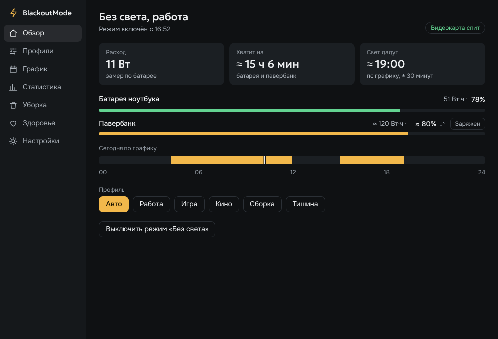
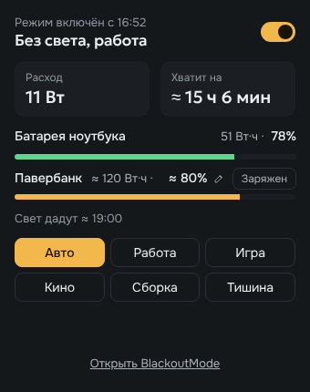
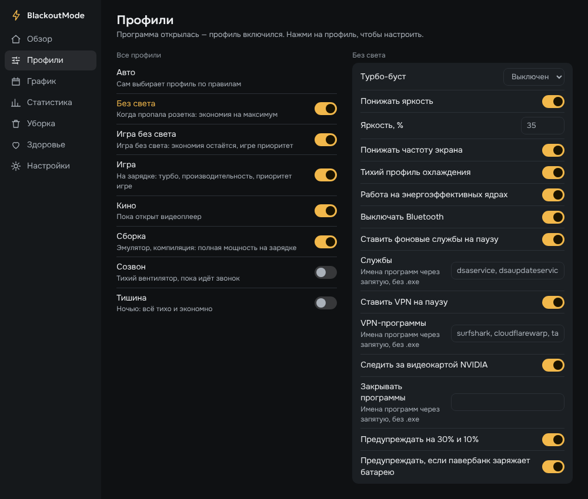
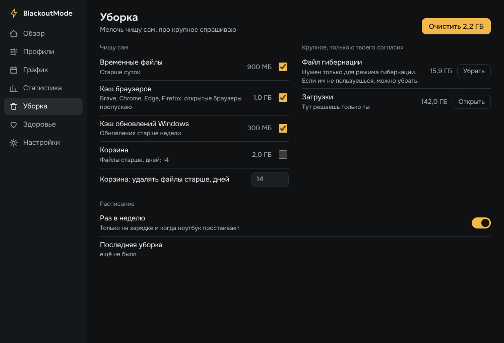

<p align="center"></p>

<h1 align="center">BlackoutMode</h1>

<p align="center"><b>Ноутбук доживає до кінця відключення</b><br>
<a href="README.md">English</a> · <a href="README.ru.md">Русский</a> · Українська</p>

<p align="center">
<a href="https://github.com/vkardin/blackoutmode/releases/latest"></a>
<a href="https://vkardin.github.io/blackoutmode/uk/"></a>
<a href="LICENSE"></a>
</p>

Невелика програма в треї Windows. Я написав її, щоб ноутбук доживав до кінця відключення світла. Коли зникає розетка, вона стискає споживання, а коли світло повертається, ставить усе як було. З часом з’явилися профілі для ігор, кіно і збирання, облік павербанка, щотижневе прибирання і вікно, де видно, що відбувається. Безкоштовно, без реєстрації, з ноутбука нічого не йде.

<p align="center"></p>

## Встановлення

1. Завантажте `BlackoutMode-x.y.z.exe` з [Releases](../../releases/latest) і покладіть куди зручно.
2. Запустіть. У треї з’явиться значок із блискавкою, а вікно під час першого запуску спитає три речі: який у вас павербанк і де ви живете, щоб брати графік відключень.
3. Лівий клік відкриває міні-панель, правий — коротке меню. Усі налаштування у вікні.

Windows 10 або 11. Права адміністратора не обов’язкові: без них не ставляться на паузу служби, не перемикається профіль охолодження і пропускається частина прибирання. Нові версії програма знаходить сама: повідомляє, ви натискаєте **«Оновити»**.

## Що вміє

- **Режим без світла.** Вмикається сам, коли зникла розетка: турбо-буст вимкнено, робота йде на енергоефективних ядрах, частота і яскравість екрана нижчі, Bluetooth вимкнено, фонові служби і VPN на паузі. На моєму ноутбуці споживання падає з 30–60 Вт до 12–17 Вт
- **На скільки вистачить.** Споживання вимірюється від батареї і запам’ятовується окремо для роботи, кіно та ігор, тому час, що залишився, чесний і від павербанка, де його виміряти не можна
- **Павербанк.** Рахує, скільки в ньому залишилося. Клацніть по його відсотку і введіть те, що показує павербанк: оцінка виправиться, а програма зрозуміє, скільки він віддає насправді
- **Графік відключень.** Для України бере відкриті дані [«Коли Є»](https://vkardin.github.io/koly/uk/): попереджає заздалегідь, дозаряджає батарею перед відключенням і сама повертає звичайний режим, коли дали світло
- **Профілі.** Гра (повна потужність на зарядці), гра без світла (вбудована графіка, щоб відеокарта спала), кіно, збирання, дзвінок, тиша. Відкрилася програма — увімкнувся профіль. Можна вибрати й вручну
- **Скільки дає економія.** Одна кнопка порівнює три хвилини без економії і три з нею та показує різницю у ватах на вашому ноутбуці
- **Віджет на екрані.** Заряд, час, що залишився, і дві тонкі смужки, батарея і павербанк, у кутку екрана, поки немає світла
- **Прибирання.** Тимчасові файли, кеш браузерів та оновлень Windows, старе в кошику. Раз на тиждень, лише на зарядці і коли ноутбук простоює
- **Здоров’я.** Знос батареї, температура, диски і попередження, коли щось нове прописалося в автозавантаження
- **Статистика.** Графік споживання за останню роботу від батареї, споживання за режимами та історія відключень
- Світла і темна тема, English, Русский, Українська

| Міні-панель біля трея | Профілі | Прибирання |
|---|---|---|
|  |  |  |

## Що де працює

Під час першого запуску програма дивиться, що є на ноутбуці, і ховає те, чого немає.

| Можливість | Що потрібно |
|---|---|
| Режим без світла, профілі, графік, павербанк, прибирання, статистика | будь-який ноутбук |
| Профіль охолодження, ліміт заряджання, відрізнити зарядку від павербанка | Lenovo IdeaPad або Legion |
| Приспати дискретну відеокарту | вбудована графіка плюс NVIDIA |
| Знижена частота екрана | екран, який її підтримує |

Сам я користуюся нею щодня на своём Lenovo. Інші ноутбуки поки не перевірені. Будь ласка, [напишіть](../../issues/new/choose), що у вас вийшло.

## Приватність

BlackoutMode не збирає даних. Налаштування, журнал і статистика лежать поруч з exe (або в `%AppData%\BlackoutMode`, якщо в ту теку не можна писати). Завантажує програма лише графік відключень і раз на добу номер останньої версії. Повідомлення в Telegram ідуть, лише якщо ви налаштували свого бота.

## Зворотний зв’язок і підтримка

- Ідеї та помилки: [GitHub Issues](../../issues/new/choose)
- Підтримати проєкт: [Ko-fi](https://ko-fi.com/vkardin) або [Donatello](https://donatello.to/vkardin)

## Збирання

Go 1.24 та інструменти LLVM для ресурсів. Три потрібні бібліотеки лежать у `third_party`, нічого не завантажується:

```
sh tools/build.sh
```

Вікно малює компонент WebView2, який є у Windows 11 (і в оновленій Windows 10). Де його немає, відкривається звичайне вікно браузера. Після закриття вікна в пам’яті від нього нічого не залишається.

## Репозиторій

| Тека | Що всередині |
|---|---|
| `*.go` | Програма. Файли із закінченням `_windows.go` працюють з Windows, решта — звичайна логіка, покрита тестами в `core_test.go` |
| [`ui/`](ui) | Вікно: один HTML-файл і шрифти |
| [`res/`](res) | Значок, маніфест і ресурс із версією |
| [`third_party/`](third_party) | go-webview2, go-winloader і частина golang.org/x/sys для Windows, у кожної своя ліцензія |
| [`tools/`](tools) | `build.sh` проганяє тести і збирає `dist/BlackoutMode-<версія>.exe` |
| [`.github/workflows/`](.github/workflows) | `test.yml` запускає тести і збирання під Windows; `release.yml` публікує реліз, коли в `main` приходить нова версія з `main_windows.go` |

## Ліцензія

[MIT](LICENSE) © vkardin. Шрифти: Geologica та Onest, SIL Open Font License (див. `ui/f`).

<!-- project-family:start -->

[**vkardin / tools — каталог усіх проєктів ↗**](https://vkardin.github.io/)
## Інші інструменти від vkardin

| Проєкт | Опис |
| --- | --- |
| **[Video Glow](https://vkardin.github.io/video-glow/)** | Підсвічування навколо відео в колір кадру. М’яке світіння, LED-стрічка і колір кімнати. [GitHub](https://github.com/vkardin/video-glow) |
| **[Leveler](https://vkardin.github.io/leveler/)** | Рівна гучність будь-якого відео: діалоги гучніше, вибухи тихіше, підсилення і швидкість. [GitHub](https://github.com/vkardin/leveler) |
| **[Video Drift](https://vkardin.github.io/video-drift/)** | Відео поверх інших вікон, субтитри, збереження позиції та нотатки до моментів. [GitHub](https://github.com/vkardin/video-drift) |
| **[Snapt](https://vkardin.github.io/snapt/)** | Скриншоти, стрілки й підписи. Застосунок для Windows, macOS і Linux та розширення браузера. [GitHub](https://github.com/vkardin/snapt) |
| **[UNI](https://vkardin.github.io/uni-homebot/)** | Домашній сервер у Telegram: застосунки, моніторинг, сповіщення та мінізастосунок. [GitHub](https://github.com/vkardin/uni-homebot) |
| **[Коли Є](https://vkardin.github.io/koly/uk/)** | Графіки відключень світла по всіх областях України: статус зараз, зворотний відлік, сьогодні й завтра. Застосунок для Android і віджет для Windows. [GitHub](https://github.com/vkardin/koly) |
| **[Tukk](https://vkardin.github.io/tukk/uk/)** | Жести телефоном для щоденних дій: струснути для ліхтарика, перевернути для тиші. Android, у розробці. [GitHub](https://github.com/vkardin/tukk) |

[github.com/vkardin](https://github.com/vkardin) · Незалежні інструменти · відкритий код
<!-- project-family:end -->
